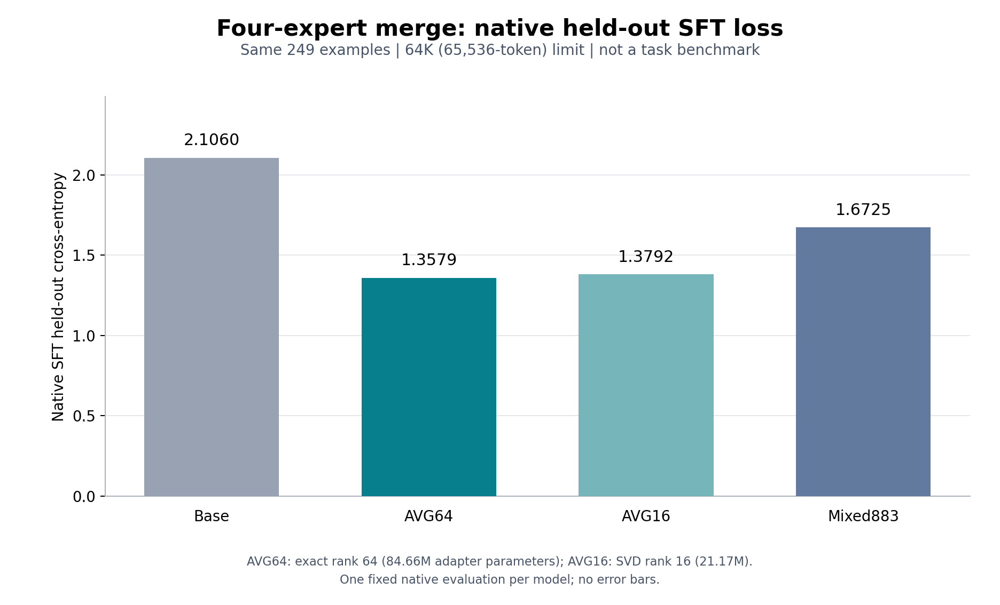

# 249条原生SFT loss-only对照：运行方案与执行

固定顺序 **Base → AVG64 → AVG16 → Mixed883**，一个4×H100、单节点、4小时作业依次运行四个全新torchrun进程。Mixed原生 `summary.json` 已实核 `passed=true, global_steps=883, final_checkpoint=.../checkpoint-883`，wall23164.161秒；作业仍设置afterok726666及summary门槛。准备时项目已释放Mixed4卡、仅余10GPU，增加4卡为14，低于16。已获审核同意，2026-10-17 02:27:22 +08:00提交并启动作业727689，节点ACD1-67、4卡、截止06:27:22；提交前再次确认现有10卡，加入后共14卡。

配置为 [sft_loss249_only_20261017.json](../configs/eval/sft_loss249_only_20261017.json)，入口 [evaluate_sft_loss_only.py](../scripts/evaluate_sft_loss_only.py)，资源配置 [Slurm](../scripts/evaluate_sft_loss_only.slurm)。结果根为 `artifacts/eval/sft_loss249_only_20261017-JOBID/`，按candidate分别保存原生配置、命令、日志与JSON指标。

## 数据和方法边界

只读取Mixed训练已经使用的同一份 `artifacts/data/candidates/mixed_existing_hle2k_20261016/val.messages.jsonl`，249条：HLE100、SWE87、Terminal42、ASI20。不构造新val、不删样本、不缩短65536上下文、不作生成或judge，不重启取消的task benchmark val。最终模型仍是预先固定的AVG64，loss结果不回流调系数或rank。

克隆Mixed原生 `training_config.json`，保持Qwen原生template、`default+ignore_empty_think` mask、BF16、SDPA/grouped_mm、ZeRO3、batch1及原Liger fused CE。SftArguments要求非空dataset，即使do_train=false也如此，因此未使用的dataset字段与val_dataset均指向同一份249条val；没有优化步骤。原生truncation_strategy=delete保留，但hook在任何forward前必须确认模板处理后仍为249条，发生过滤就失败，不产生缩题分数。`prediction_loss_only=true, predict_with_generate=false`，不物化/收集full-vocabulary预测。

本轮只记录原生全249条 `eval_loss`。它沿用Trainer的batch1均值语义，不冒称自行计算的全局token加权NLL。分域条数留存；暂不增加四次分域forward，也不改原生收集器来推算域分数。

## 单一hook为何可靠

已读取本次环境安装的实际源码（以下路径均相对 `artifacts/envs/sft/lib/python3.12/site-packages/`）：

- `swift/pipelines/train/sft.py:164–190, 258–271`：run准备原生dataset/model/Trainer后进入self.train；原train无条件trainer.train，单独do_train=false不能保证零训练。现有训练args中的do_train本身就是false。
- 新类只覆盖 `train(self, trainer)`，调用loss-only helper；helper冻结参数、直接 `trainer.evaluate()`，前后检查optimizer/scheduler为空、global_step=0，且输出无checkpoint目录。
- `swift/trainers/patcher.py:35–56, 87–102`：训练Progress/Printer回调的on_log依赖on_train_begin赋值的start_time。hook仅移除这两个训练日志回调，避免evaluate-only错误，不改变template/model/loss。
- `transformers/trainer.py:2653–2682`：直接evaluate时走DeepSpeed `inference=True`。
- `transformers/integrations/deepspeed.py:617–626`：该分支要求ZeRO3，去掉optimizer/scheduler配置并保持二者为None。
- `swift/trainers/seq2seq_trainer.py:58–82`：prediction_loss_only且predict_with_generate=false走普通带label prediction_step，不进入TransformersEngine.generate。
- 继续调用既有 `scripts/sft_eval_loss.py` 的Liger patch；它使带label的eval跳过完整logits，沿用训练时的同一fused causal CE。

Base使用tuner_type=full且无adapter，不新建随机LoRA；其他三项均由原生from_pretrained读取已有adapter rank/alpha。GPU进程分开，上一候选退出后才加载下一候选。

## 已完成CPU验收

实际读取原249条val并通过固定配置检查；纯CPU spy Trainer只发生“freeze → remove两个训练日志回调 → evaluate”。train、create_optimizer、generate、save_model均设置为一旦调用就失败；输出目录保持空；故意提供248条时在evaluate前拒绝。没有模型forward、GPU或伪造loss数值。证据见 [CPU收据](source_snapshots/sft_loss_only_cpu_20261017.json)。GPU阶段还会对原生处理后的eval_dataset再检查249条及上述状态，补上真实原生模型前向验收。

本次实际使用 `sbatch scripts/evaluate_sft_loss_only.slurm` 提交727689。Terminal agent另以安装源码只读复核了hook、parse_args_from_dict实例返回与249条/step0检查，无需新增探针。总日志 `artifacts/eval/sft-loss249-only-727689.log`，结果根 `artifacts/eval/sft_loss249_only_20261017-727689/`。这是现有SFT loss对照，不改任何在运行的服务、训练文件或正式benchmark队列。

## 原生memory(GiB)含义

`swift/trainers/patcher.py:27–29` 把 `state.max_memory` 更新为此前值与 `get_max_reserved_memory()` 的较大值，再四舍五入两位；`swift/utils/torch_utils.py:434–440` 取设备列表的 `torch.cuda.max_memory_reserved` 最大值，除以2^30。`swift/utils/env.py:64–75` 在本次torchrun4、LOCAL_WORLD_SIZE4下判断is_mp=false，所以设备列表为[None]，即每个进程当前CUDA设备。

只有world_process_zero写/打印日志（patcher.py:53–56、96–102），因此本次对外值是 **rank0当前GPU的PyTorch caching allocator peak-reserved high-water mark**；不是allocated、不是四卡总量、不是跨rank全局最大，也不包括完整nvidia-smi设备内存。峰值自最近一次reset计；本次原args `skip_memory_metrics=true`，HF内存tracker不执行其reset_peak_memory_stats。报告宜保留这个范围，或保守称native logged maximum。

## 四项实际结果与资源释放

原生结果根 `artifacts/eval/sft_loss249_only_20261017-727689/summary.json` 已写 `complete=true`。四项均是模板处理后完整249条、max_length65536、global_step0，前后optimizer/scheduler为None，无训练、生成或checkpoint目录；未缩上下文、删题或重跑。

| 固定候选 | 原生eval_loss | 原生eval token accuracy |
| --- | ---: | ---: |
| base | 2.105976343155 | 0.868536029685 |
| avg64 | 1.357921004295 | 0.881281322498 |
| avg16 | 1.379222631454 | 0.881137126854 |
| mixed883 | 1.672462821007 | 0.889329041644 |

AVG16相对AVG64的loss增加0.021301627159（固定rank16截断SVD消融，未重新选择系数或主模型）。Mixed883的 `1.672462821006775` 与原训练step883同一249条的native eval_loss逐位相同，可交叉核验原生模板、mask、Liger与checkpoint读取的一致性；不据此声称任务benchmark表现。主模型继续为预先冻结AVG64。这里只报告整249条，没有额外分域forward；token accuracy是原生带label指标，不是生成式benchmark准确率。

作业727689于2026-10-17 02:56:31 +08:00自然COMPLETED、exit0:0，Elapsed29分09秒，4卡均已释放，计1.943333 GPU小时。四个候选顺序共用同一个4卡作业，不把各候选耗时再重复计费；加载/初始化与缓存不同也不作吞吐比较。完整指标、实际sacct与Mixed原训练复现证据见[执行收据](source_snapshots/sft_loss_only_execution_20261017.json)。

## 指标图、CSV与重画



[PNG](../curves/merge_loss249_20261017.png)、[精确数值CSV](../curves/merge_loss249_20261017.csv)与[小型原始summary](../curves/merge_loss249_20261017/source_summary.json)一并归档；source_summary是727689完成后的原生summary原文副本，不附完整机器日志。固定顺序为Base、AVG64、AVG16、Mixed883，同249条、64K/65536上限、同原生teacher-forced loss路径；每模型只有一次固定评估，没有虚构error bar。PNG已实际目视，标题、坐标、四个数值与容量说明均可读、无裁切。

重画只需本机matplotlib，无GPU或模型forward：

```bash
python3 scripts/plot_merge_loss.py
```

[脚本](../scripts/plot_merge_loss.py)默认直接读取上述真实summary，检查四项完整249条/65536/step0后同时写PNG与CSV。AVG64是精确rank64 adapter，84,664,320参数；AVG16是固定rank16截断SVD adapter，21,166,080参数，前者adapter容量为后者4倍。因此此图记录已有SFT验证集的loss与固定容量/压缩消融，不能把差异单独归因于同容量下的合版方法，也不表示任何任务benchmark提升。预先冻结的AVG64选择不随图中结果改变。
